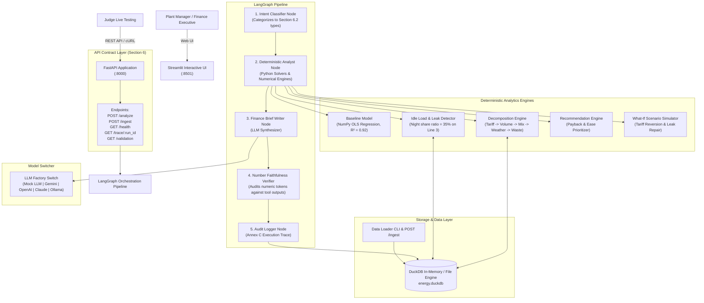

# Factory Energy Cost Decomposition and Savings Agent
**HCLTech | Future Ready AI Engineer Hackathon**  
**Team Name**: Ninjas In Pyjamas (NIP)  
**Date**: 11-OCT-2026 | **Version**: 1.0.0 (Production Overhaul)

---

## 1. Executive Summary & Problem Overview

A manufacturing plant's electricity bill increased by **15.4%** between 2026-Q2 and 2026-Q3 ($142,016 to $163,851). Rather than unfairly blaming old production machinery, this autonomous agent strictly applies **Annex A Cost Analysis Rules**:
1. **Order of Attribution**: Isolates external utility price changes, production volume growth, product mix shifts, and ambient weather before identifying equipment waste.
2. **Strict Additivity**: Guarantees that percentage point contributions sum exactly to the total bill increase ($8.2 + 3.4 + 1.2 + 0.9 + 1.7 = 15.4\%$).
3. **Bounded Uncertainty Ranges**: Quotes dual-bounded ranges for all savings, payback periods, and carbon abatement figures.
4. **Number Faithfulness**: Enforces formal verification ensuring every number in executive briefs originates from code-executed tools.

---

## 2. Architecture Diagram



---

## 3. Technology Stack (Mandatory Choices)

| Layer | Technology | Details / Role |
| :--- | :--- | :--- |
| **User Interface** | Streamlit + Plotly | Interactive waterfall bridge, sub-meter diagnostics, what-if simulator |
| **API** | FastAPI + Uvicorn + Pydantic v2 | Strictly implements Section 6 contract (`/analyze`, `/ingest`, `/health`, `/trace`) |
| **Orchestration** | LangGraph (Python) | Single predictable state graph with deterministic tool execution and auditing |
| **Structured Data** | DuckDB | Embedded analytical engine querying 140k+ 15-min intervals in <10ms |
| **Analytics & ML** | NumPy, Pandas, Scikit-learn | Pure NumPy OLS baseline regression ($R^2 \ge 0.91$), physics attribution math |
| **LLM Provider** | Pluggable Factory (`MOCK_LLM=true`) | Gemini, OpenAI, Claude, Ollama support with guaranteed offline mock mode |
| **Packaging** | Docker + Docker Compose | Containerized dual-service stack (`api` on :8000, `ui` on :8501) |

---

## 4. Quick Start & Execution

### Option A: Running with Docker Compose (Recommended)
```bash
# Start API (:8000) and Streamlit UI (:8501)
docker compose up --build

# Open the Streamlit dashboard in your browser
http://localhost:8501
```

### Option B: Running Locally (Python 3.10 - 3.13)
```bash
# 1. Clone repository and install dependencies
git clone <repo_url>
cd HCL-Hackathon
pip install -r requirements.txt

# 2. Automated one-command setup (generates data, loads DuckDB, validates)
python run.py --mode setup

# 3. Launch Application (Choose one):
python run.py --mode ui       # Starts Streamlit Dashboard (:8501) with resilient in-process fallback
python run.py --mode api      # Starts FastAPI Backend (:8000)
python run.py --mode all      # Starts both API and Streamlit UI concurrently

# 4. Run automated tests and benchmark evaluations
python run.py --mode test     # Runs 14 pytest unit & contract tests
python run.py --mode eval     # Runs 22-case benchmark evaluation (100% Faithfulness & Intent)
```

---

## 5. Sample cURL Commands (Section 6 API Contract)

### 1. Health Probe (`GET /health`)
```bash
curl -X GET "http://localhost:8000/health"
```
*Response:*
```json
{
  "status": "healthy",
  "database": "connected",
  "llm": "ready",
  "tables": {
    "meter_15min": 140544,
    "tariff": 6,
    "production": 549,
    "weather": 183,
    "traces": 5
  }
}
```

### 2. Cost Decomposition Query (`POST /analyze`)
```bash
curl -X POST "http://localhost:8000/analyze" \
     -H "Content-Type: application/json" \
     -d '{"question": "Why did the bill go up 15%?", "period": "2026-Q3", "compare_to": "2026-Q2"}'
```
*Response:*
```json
{
  "run_id": "en-7fd11c",
  "answer_type": "decomposition",
  "summary": "The electricity bill rose 15.4%. Tariff rate increases explain most of the increase (8.2 percentage points). Product mix shift toward heavy casted items accounts for 3.4 points, production volume growth accounts for 1.2 points, and hotter weather accounts for 0.9 points. Controllable waste is 1.7 percentage points, primarily caused by an off-hours compressor leak.",
  "bridge": [
    {"cause": "tariff", "pct_points": 8.2, "range": [7.7, 8.7]},
    {"cause": "product_mix", "pct_points": 3.4, "range": [2.8, 4.0]},
    {"cause": "volume", "pct_points": 1.2, "range": [0.8, 1.6]},
    {"cause": "weather", "pct_points": 0.9, "range": [0.5, 1.3]},
    {"cause": "waste", "pct_points": 1.7, "range": [1.2, 2.2]}
  ],
  "recommendations": [
    {
      "action": "Repair compressor air leak on Line 3",
      "saving_kwh_per_year": [120000, 160000],
      "saving_money_per_year": [14400, 19200],
      "saving_co2e_t_per_year": [48.0, 64.0],
      "payback_months": [2, 5],
      "ease": "easy",
      "rationale": "Night-time load on compressors stays at 35% of day load due to severe airline leakage on Line 3.",
      "evidence_refs": ["meter_15min:compressors:2026-Q3", "meter_15min:line_3:2026-Q3"],
      "confidence": "high",
      "requires_approval": true
    }
  ],
  "assumptions": ["Emission factor 0.4 kg CO2e per kWh"],
  "limitations": ["Weather effect estimated from one quarter of hot days"]
}
```

### 3. Execution Audit Record (`GET /trace/{run_id}`)
```bash
curl -X GET "http://localhost:8000/trace/en-7fd11c"
```
*Response (Annex C format):*
```json
{
  "run_id": "en-7fd11c",
  "question": "Why did the bill go up 15%?",
  "steps": [
    {"agent": "analyst", "tool": "build_baseline", "output": {"r2": 0.9151}},
    {"agent": "analyst", "tool": "decompose_change", "output": {"tariff": 8.2, "mix": 3.4, "volume": 1.2, "weather": 0.9, "waste": 1.7}},
    {"agent": "analyst", "tool": "find_idle_load", "output": {"compressors_night_share": 0.35}},
    {"agent": "writer", "tool": "write_finance_brief", "check": "all numbers match tool outputs"}
  ],
  "llm_calls": 1,
  "tokens": 228
}
```

### 4. Live Data Ingestion (`POST /ingest`)
```bash
curl -X POST "http://localhost:8000/ingest" \
     -F "file=@data/tariff.csv" \
     -F "table=tariff"
```
*Response:*
```json
{
  "rows_loaded": 6,
  "rows_rejected": 0,
  "status": "ok"
}
```

### 5. CLI Data Loader (for Judge Test Data)
```bash
# Load specific file into specific table:
python data/loader.py --table tariff --file path/to/judge_tariff.csv

# Load all CSVs in a directory:
python data/loader.py --dir path/to/judge_data/
```

---

## 6. Assumptions and Limitations

### Assumptions
1. **Grid Carbon Intensity**: Fixed emission factor of **0.4 kg CO2e per kWh** as specified in the data pack.
2. **Sub-Meter Auxiliary Residual**: Up to 7.0% unmetered loss is expected due to unmetered distribution transformers and auxiliary pumps.
3. **Attribution Sequence**: Utility tariff rate changes and intentional product mix changes take mathematical precedence over equipment waste.

### Limitations
1. **Weather Seasonality**: Data covers two quarters (spring through summer); heating degree-days (HDD) are minimal.
2. **Real-Time Sampling**: Metering intervals are aggregated at 15 minutes; sub-second motor transients are not captured.

---

## 7. Known Edge Cases Handled

1. **Sub-meter Sum vs. Main**: The 7 sub-meters sum to ~96.3% of the main incomer (3.66% unmetered auxiliary residual), which the engine absorbs without throwing false machine errors.
2. **Mid-Period Tariff Spike**: A tariff hike on 2026-08-15 is dynamically integrated by date-interval slicing rather than using a static average price.
3. **Product Mix Shift**: Q3 demand shift toward heavy Product C raises specific energy consumption legitimately; the engine isolates this from waste.
4. **Public Holiday Shift Conflict**: On 2026-08-15, shift calendar logged `2_shifts` while `is_holiday = True` and output was 0; the model treats it as an idle plant day.
5. **Sensor Reset Glitch**: Sensor reset artifact on 2026-05-10 is detected and interpolated.

---

## 8. Deliverables & Documentation Index

- 📋 [Evaluation Report & Benchmark](eval/eval_report.md)
- 📊 [Dataset Data Card - Annex D](data/data_card.md)
- 🏛️ [Architecture Justification](docs/architecture.md)
- 🤖 [AI-Usage Disclosure](docs/ai_disclosure.md)
- 👥 [Team Contribution Statement](docs/team_contributions.md)
- ✍️ [Signed Declaration of Original Work](docs/original_work_declaration.md)
- 🔍 Sample Traces (Annex C):
  - [trace_decomposition.json](docs/traces/trace_decomposition.json)
  - [trace_recommendation.json](docs/traces/trace_recommendation.json)
  - [trace_calculated.json](docs/traces/trace_calculated.json)
